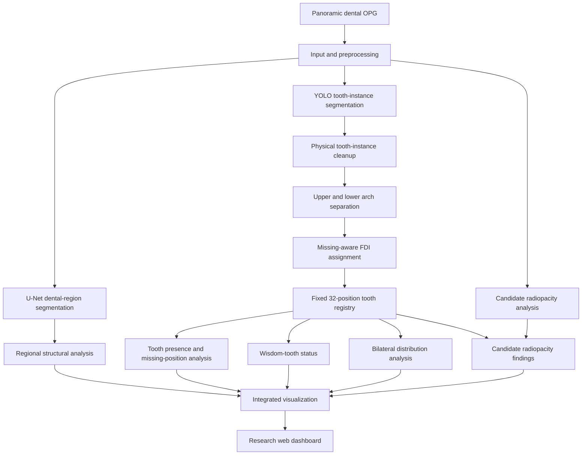

# CISCom 2026 — Hybrid AI-Based Panoramic OPG Analysis

A research prototype for structured analysis of panoramic dental radiographs (Orthopantomograms/OPGs), combining semantic dental-region segmentation, tooth-instance segmentation, anatomical FDI assignment, and tooth-position analysis.

> **Research prototype only.** This software is not a clinically validated diagnostic system and must not replace professional dental examination or interpretation.

## Overview

The pipeline combines three analysis branches:

1. **U-Net semantic segmentation** — identifies the dental region and supports regional structural analysis.
2. **YOLO instance segmentation and FDI assignment** — detects tooth instances, applies physical-instance cleanup, separates arches, and assigns detections to a fixed 32-position FDI tooth registry.
3. **Radiopacity analysis** — identifies candidate high-radiopacity regions for further review; these candidates are not definitive restoration or disease diagnoses.

The dashboard presents the original OPG, segmentation visualization, numbered tooth positions, tooth-presence summary, wisdom-tooth status, bilateral distribution insights, and radiopacity screening information.

## Architecture Diagram



The branches are complementary: U-Net supports dental-region/structural analysis, while YOLO tooth-instance segmentation supports individual-tooth localization and registry assignment. Radiopacity results are candidate image features, **not confirmed dental diagnoses**.

## Implementation Pipeline

1. **Input:** Load a panoramic dental X-ray (OPG). Image quality and preprocessing can influence subsequent segmentation and numbering.
2. **Dental-region segmentation:** Use the U-Net component (`segmentation/unet_dental_region.py`) to obtain a dental-region mask for regional analysis.
3. **Tooth-instance segmentation:** Use the YOLO component (`segmentation/yolo_tooth_instances.py`) to generate tooth-instance candidates.
4. **Instance resolution:** Clean overlapping or duplicate tooth detections so raw model outputs are not assumed to be distinct physical teeth.
5. **Anatomical assignment:** Separate upper/lower arches, perform missing-aware FDI assignment (`fdi/fdi_assigner.py`), and populate the 32-position tooth registry (`fdi/tooth_registry.py`).
6. **Position-based analysis:** Analyze presence/missing positions, wisdom teeth, and bilateral pair states (`fdi/presence_analysis.py` and evaluation modules).
7. **Radiopacity screening:** Inspect candidate high-radiopacity regions (`anatomy_insights/radiopacity_analysis.py`), without claiming definitive restoration or disease detection.
8. **Visualization:** Integrate outputs in the research dashboard (`dashboard/app.py`, `dashboard/templates/index.html`).

The orchestration entry point is `pipeline/hybrid_inference.py`. Consult the source for exact runtime configuration and model input/output contracts.

## Module Responsibilities

| Module | Responsibility |
| --- | --- |
| `segmentation/` | U-Net dental-region and YOLO tooth-instance inference |
| `fdi/` | FDI assignment, registry, presence analysis |
| `anatomy_insights/` | Candidate radiopacity analysis |
| `pipeline/` | Hybrid inference orchestration |
| `dashboard/` | Web UI and visualization |
| `evaluation/` | Segmentation, presence, wisdom-tooth, bilateral, and FDI evaluation |


## Repository Structure

```text
.
├── anatomy_insights/
│   └── radiopacity_analysis.py
├── configs/
├── dashboard/
│   ├── app.py
│   └── templates/
│       └── index.html
├── evaluation/
│   ├── evaluate_bilateral.py
│   ├── evaluate_fdi.py
│   ├── evaluate_postprocessed_segmentation.py
│   ├── evaluate_presence.py
│   ├── evaluate_segmentation.py
│   └── evaluate_wisdom_teeth.py
├── experiments/
├── fdi/
│   ├── fdi_assigner.py
│   ├── presence_analysis.py
│   └── tooth_registry.py
├── pipeline/
│   └── hybrid_inference.py
├── segmentation/
│   ├── unet_dental_region.py
│   └── yolo_tooth_instances.py
├── structural_analysis/
├── requirements.txt
└── README.md
```

## Requirements

- Python compatible with the installed TensorFlow, PyTorch, and Ultralytics versions
- A configured Python virtual environment
- The required U-Net and YOLO model weights
- Access to a compatible OPG dataset for inference and evaluation

## Installation

Create and activate a virtual environment:

```bash
python3 -m venv .venv
source .venv/bin/activate
python -m pip install --upgrade pip
pip install -r requirements.txt
```

The supplied requirements reflect versions installed in the original development environment. Compatibility should be verified on other operating systems and hardware.

## Model Weights and Dataset

Model weights and datasets are intentionally excluded from version control.

Expected default model paths:

- `models/unet/dental_xray_seg.h5`
- `models/fdi_seg_v1/best.pt`

Place the appropriate model files at these paths, or configure the relevant model paths in the source code.

The evaluation scripts expect the FDI test dataset in:

```text
datasets/fdi_500/test/
├── images/
└── labels/
```

Each test image must have its corresponding annotation file. The annotation class-to-FDI mapping must match the evaluation code.

Dataset access, annotation provenance, and redistribution permissions must be established separately before sharing data.

## Run the Dashboard

After installing dependencies and configuring the required model weights:

```bash
python -m dashboard.app
```

Open the local address printed by Flask in your browser. The dashboard is intended for local research use.

The `Run OPG Dashboard.command` launcher is provided for macOS environments.

## Evaluation

The following evaluation scripts are included:

| Script | Purpose |
|---|---|
| `evaluation/evaluate_presence.py` | Tooth-position presence/missing evaluation |
| `evaluation/evaluate_wisdom_teeth.py` | Wisdom-tooth position evaluation |
| `evaluation/evaluate_bilateral.py` | Bilateral pair-state agreement |
| `evaluation/evaluate_fdi.py` | FDI assignment evaluation |
| `evaluation/evaluate_segmentation.py` | Instance segmentation metrics |
| `evaluation/evaluate_postprocessed_segmentation.py` | Postprocessed segmentation evaluation |

Run evaluations from the project root with the configured environment:

```bash
python -m evaluation.evaluate_presence
python -m evaluation.evaluate_wisdom_teeth
python -m evaluation.evaluate_bilateral
```

## Reported Evaluation Results

The following results were reproduced in the development environment using 50 held-out OPG images and the corresponding annotations.

| Metric | Result | Evaluation units |
|---|---:|---:|
| Tooth-position accuracy | 94.88% | 1,600 FDI positions |
| Wisdom-tooth accuracy | 92.00% | 200 wisdom-tooth positions |
| Bilateral three-category agreement | 91.00% | 800 bilateral pair states |

### Bilateral Agreement Definition

The bilateral evaluator compares 16 contralateral tooth pairs per image. Each pair is classified as both present, both absent, or asymmetric. Agreement is the proportion of predicted pair categories that match the annotated ground-truth categories.

Under this three-category definition, the evaluation yielded 728/800 correct pair states (91.00%). Exact left/right occupancy agreement was 724/800 (90.50%), a distinct and stricter metric.

Other reported metrics include:

- Missing-tooth precision: 85.81%
- Missing-tooth recall: 86.96%
- Missing-tooth F1: 86.38%

Results apply to the evaluated dataset and setup. They should not be interpreted as clinical performance guarantees or assumed to generalize to other populations, scanners, or image acquisition conditions.

## Limitations and Safety

- This is a research prototype, not a medical device.
- FDI assignment and tooth presence can be affected by overlap, image quality, missing teeth, and anatomical variation.
- Radiopacity candidates are not definitive identification of fillings, crowns, implants, caries, or other clinical findings.
- The system requires further independent validation on larger, diverse datasets and expert-reviewed annotations.
- A qualified dental professional must make all clinical interpretations and decisions.

## Citation

If you use this work, cite the associated CISCom 2026 paper using its official bibliographic details once available.

## License

No license has been specified yet. All rights reserved unless the repository owner adds an explicit license. Do not assume permission to reuse or redistribute this code or associated datasets.
