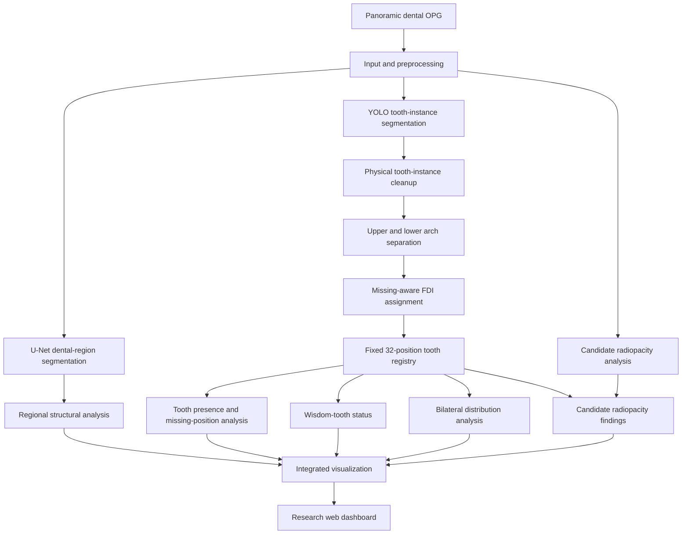

# CISCom 2026 — System Architecture and Implementation Pipeline

## Scope
This document describes the research prototype presented at CISCom 2026. It is intended for research and educational review, not clinical diagnosis.

## Architecture diagram

The branches are complementary: U-Net supports dental-region/structural analysis, while YOLO tooth-instance segmentation supports individual-tooth localization and registry assignment. Radiopacity results are candidate image features, **not confirmed dental diagnoses**.

## Processing stages

1. **Input:** Load a panoramic dental X-ray (OPG). Image quality and preprocessing can influence subsequent segmentation and numbering.
2. **Dental-region segmentation:** Use the U-Net component (`segmentation/unet_dental_region.py`) to obtain a dental-region mask for regional analysis.
3. **Tooth-instance segmentation:** Use the YOLO component (`segmentation/yolo_tooth_instances.py`) to generate tooth-instance candidates.
4. **Instance resolution:** Clean overlapping or duplicate tooth detections so raw model outputs are not assumed to be distinct physical teeth.
5. **Anatomical assignment:** Separate upper/lower arches, perform missing-aware FDI assignment (`fdi/fdi_assigner.py`), and populate the 32-position tooth registry (`fdi/tooth_registry.py`).
6. **Position-based analysis:** Analyze presence/missing positions, wisdom teeth, and bilateral pair states (`fdi/presence_analysis.py` and evaluation modules).
7. **Radiopacity screening:** Inspect candidate high-radiopacity regions (`anatomy_insights/radiopacity_analysis.py`), without claiming definitive restoration or disease detection.
8. **Visualization:** Integrate outputs in the research dashboard (`dashboard/app.py`, `dashboard/templates/index.html`).

The orchestration entry point is `pipeline/hybrid_inference.py`. Consult the source for exact runtime configuration and model input/output contracts.

## Repository modules

| Module | Responsibility |
| --- | --- |
| `segmentation/` | U-Net dental-region and YOLO tooth-instance inference |
| `fdi/` | FDI assignment, registry, presence analysis |
| `anatomy_insights/` | Candidate radiopacity analysis |
| `pipeline/` | Hybrid inference orchestration |
| `dashboard/` | Web UI and visualization |
| `evaluation/` | Segmentation, presence, wisdom-tooth, bilateral, and FDI evaluation |

## Reported evaluation

The repository README reports results on **50 held-out OPG images**:

| Metric | Reported result | Units |
| --- | ---: | --- |
| Tooth-position accuracy | 94.88% | 1,600 FDI positions |
| Wisdom-tooth accuracy | 92.00% | 200 wisdom-tooth positions |
| Bilateral three-category agreement | 91.00% | 800 bilateral pair states |

These are results reported for the evaluation setup, not guarantees of clinical performance or generalization.

## Reproducibility and limitations

See [README](../README.md) for setup, model locations, execution, and evaluation commands. Trained model weights and datasets are **not included** in this public repository. The system is a research prototype; qualified dental professionals must make clinical decisions.
